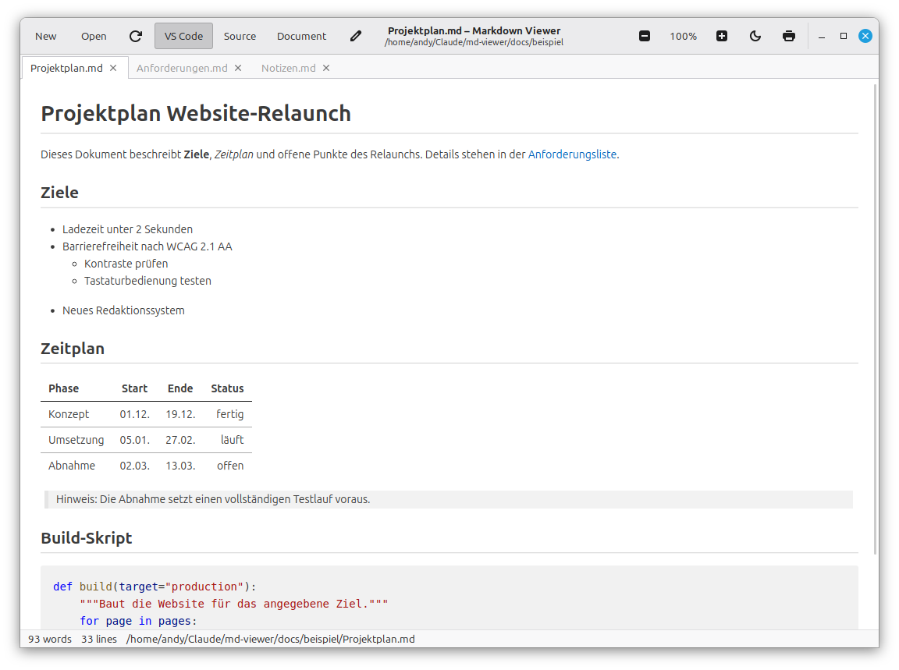
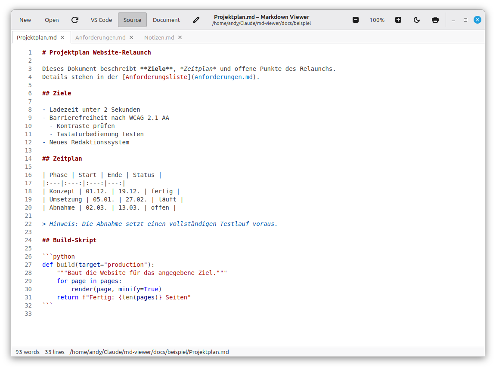
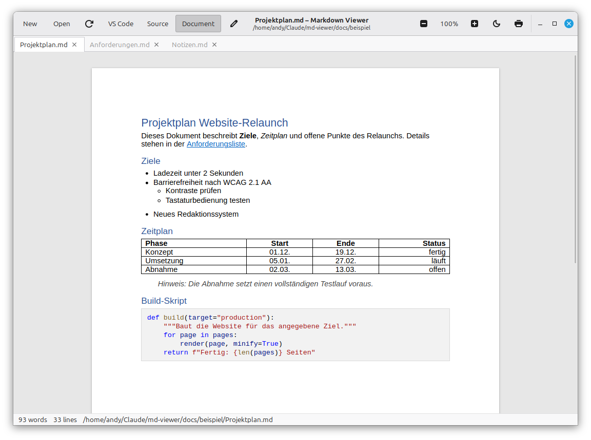
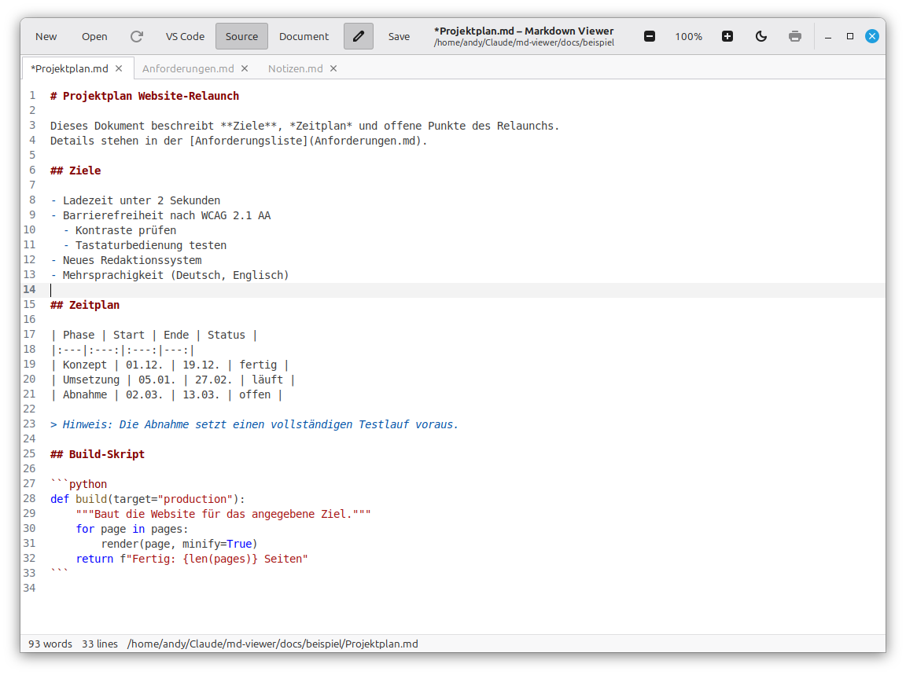
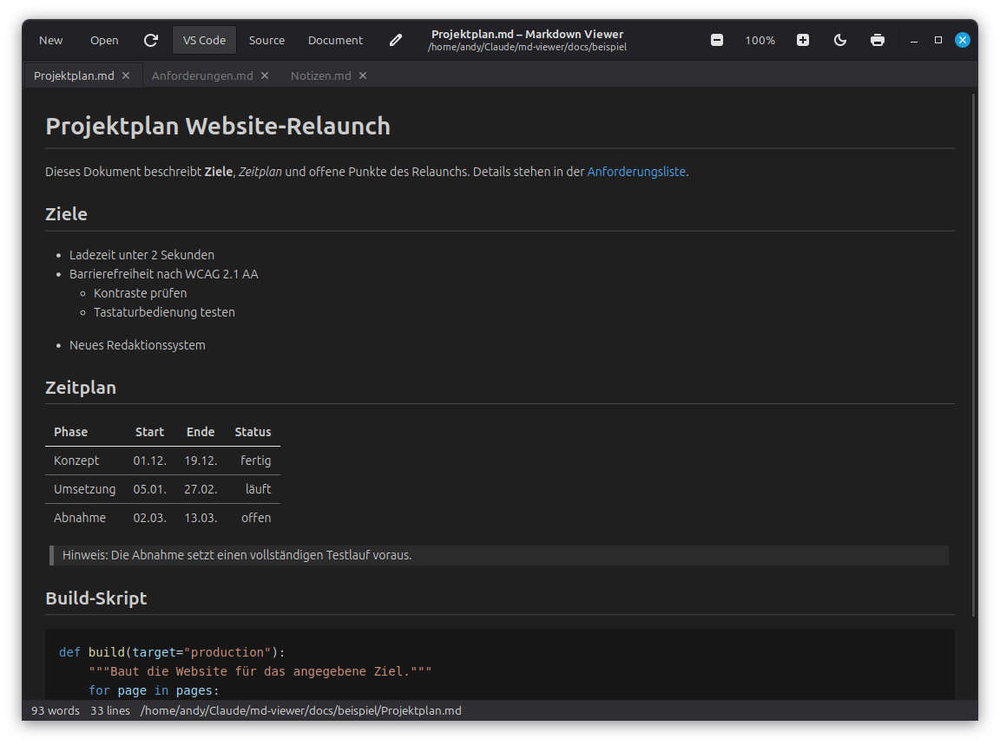
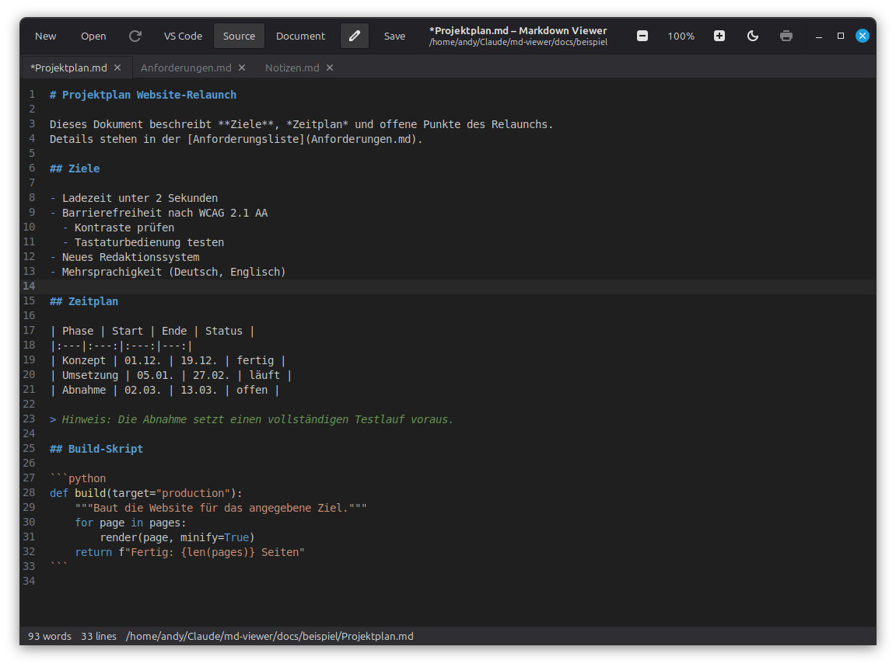

# Markdown Viewer – Benutzerhandbuch

Stand: 07.11.2026

Dieses Handbuch erklärt die Bedienung des Markdown Viewers Schritt für Schritt. Installation, Voraussetzungen und Fehlerbehebung stehen in der [Anwenderdokumentation](ANWENDERDOKUMENTATION.md).

Zum Ausprobieren liegen im Ordner [beispiel](beispiel/) drei Dateien, die auch in den Bildern dieses Handbuchs zu sehen sind.

## 1. Das Fenster im Überblick



**Kopfzeile, von links nach rechts:**

| Element | Funktion |
|---|---|
| **New** | Neue Markdown-Datei anlegen (Abschnitt 7) |
| **Open** | Eine oder mehrere Dateien öffnen (Abschnitt 2) |
| ↻ (Pfeil im Kreis) | Datei neu von der Festplatte laden |
| **VS Code \| Source \| Document** | Ansicht wählen (Abschnitt 4); die aktive Ansicht ist hinterlegt |
| ✎ (Stift) | Bearbeiten ein- und ausschalten (Abschnitt 6) |
| **Save** | Speichern; nur sichtbar, solange Sie bearbeiten |
| Titel | Name und Ordner der aktuellen Datei; ein `*` davor bedeutet: ungespeicherte Änderungen |
| − **100 %** + | Verkleinern, Zoom zurücksetzen (Klick auf die Prozentzahl), vergrößern |
| ☾ (Mond) | Theme wählen: wie das System, hell oder dunkel |
| Drucker | Drucken oder als PDF speichern |

**Darunter:**

- **Tab-Leiste:** ein Tab pro geöffneter Datei, mit Schließen-Kreuz. Fährt man mit der Maus über einen Tab, wird der vollständige Pfad angezeigt.
- **Inhalt:** die Datei in der gewählten Ansicht.
- **Statusleiste:** Anzahl der Wörter und Zeilen sowie der vollständige Pfad der Datei.

## 2. Dateien öffnen

Es gibt mehrere Wege, eine Datei zu öffnen. Jede Datei öffnet in einem eigenen Tab.

- **Über „Open“ (Strg+O):** Im Dialog eine oder mehrere Dateien auswählen (mehrere mit gedrückter Strg- oder Umschalttaste) und **Open** klicken. Der Dialog zeigt zunächst nur Markdown-Dateien; über die Auswahl unten rechts lassen sich alle Dateien anzeigen.
- **Per Doppelklick im Dateimanager:** Läuft der Viewer schon, erscheint die Datei als neuer Tab im vorhandenen Fenster.
- **Per Ziehen:** Eine `.md`-Datei aus dem Dateimanager in das Fenster ziehen.
- **Über einen Link:** Ein Klick auf einen Link zu einer anderen Markdown-Datei öffnet diese in einem neuen Tab. Links zu Webseiten öffnen im Browser.

Ist eine Datei schon geöffnet, wird kein zweiter Tab angelegt; der Viewer wechselt zu ihrem Tab.

Wenn eine Datei von einem anderen Programm geändert wird, aktualisiert der Viewer die Anzeige automatisch.

## 3. Mit Tabs arbeiten

| Aktion | So geht's |
|---|---|
| Zu einem Tab wechseln | Auf den Tab klicken, oder Strg+Tab (nächster) bzw. Strg+Umschalt+Tab (vorheriger); alternativ Strg+Bild↓ / Strg+Bild↑ |
| Tab schließen | Auf das Kreuz im Tab klicken oder Strg+W |
| Reihenfolge ändern | Einen Tab mit der Maus an eine andere Stelle ziehen |
| Fenster schließen | Strg+Q oder das Kreuz oben rechts |

Jeder Tab merkt sich seine eigene Ansicht und seinen eigenen Zoom. Sie können also zum Beispiel eine Datei bearbeiten und daneben eine andere als Dokument lesen. Die Kopfzeile zeigt immer den Stand des gerade gewählten Tabs.

Wird der letzte Tab geschlossen, zeigt das Fenster „No document“. Ein weiteres Strg+W schließt dann das Fenster.

## 4. Ansichten

Die Ansicht wechseln Sie über die drei Schaltflächen in der Kopfzeile oder mit Strg+1, Strg+2 und Strg+3. Jede neu geöffnete Datei startet in der VS-Code-Ansicht. Beim Wechsel bleibt die Leseposition ungefähr erhalten.

### VS Code (Strg+1)

So zeigt auch VS Code eine Markdown-Vorschau: über die volle Fensterbreite, mit grauen Codeblöcken und Linien unter den großen Überschriften (Bild in Abschnitt 1).

### Source (Strg+2)

Der Quelltext der Datei mit Zeilennummern und farbiger Hervorhebung: Überschriften, Listenzeichen, Links, Zitate und Code sind unterschiedlich eingefärbt. In Codeblöcken wird der Code in seiner Sprache hervorgehoben, wenn sie angegeben ist (z. B. ```` ```python ````).



### Document (Strg+3)

Die Datei sieht aus wie ein Word-Dokument: eine weiße A4-Seite auf grauem Hintergrund, Schrift Calibri 11 pt, blaue Überschriften und Tabellen mit Gitternetz.



## 5. Zoom

| Aktion | Kopfzeile | Tastatur |
|---|---|---|
| Vergrößern | **+** | Strg++ |
| Verkleinern | **−** | Strg+− |
| Zurücksetzen auf 100 % | Klick auf die Prozentzahl | Strg+0 |

Der Zoom reicht von 30 % bis 300 % und gilt nur für den aktuellen Tab, auch im Editor.

## 6. Bearbeiten

### Bearbeiten starten

1. Klicken Sie auf den **Stift** in der Kopfzeile oder drücken Sie **Strg+E**.
2. Der Viewer wechselt automatisch in die Source-Ansicht und zeigt den Editor. Die Leseposition bleibt ungefähr erhalten.
3. Schreiben Sie wie in jedem Texteditor. Rückgängig machen mit **Strg+Z**, wiederholen mit **Strg+Umschalt+Z**.



Sobald Sie etwas ändern, erscheint ein `*` vor dem Dateinamen im Tab und im Titel.

### Speichern

Klicken Sie auf **Save** oder drücken Sie **Strg+S**. Das `*` verschwindet. Sie können danach weiterschreiben.

### Bearbeiten beenden

Klicken Sie erneut auf den Stift oder drücken Sie Strg+E. Die Source-Ansicht zeigt dann den gespeicherten Stand.

Haben Sie noch nicht gespeichert, fragt der Viewer nach:

| Schaltfläche | Wirkung |
|---|---|
| **Save** | Änderungen speichern und fortfahren |
| **Discard** | Änderungen verwerfen und fortfahren |
| **Cancel** | Nichts tun; Sie bleiben im Editor |

Dieselbe Frage kommt, wenn Sie mit ungespeicherten Änderungen die Ansicht wechseln, den Tab schließen oder das Fenster schließen. Beim Schließen des Fensters wird für jeden betroffenen Tab einzeln gefragt.

### Gut zu wissen

- Während der Bearbeitung sind **Neu laden** und **Drucken** ausgegraut, und Änderungen anderer Programme an der Datei werden nicht übernommen. Speichern überschreibt solche Änderungen.
- Ist der Stift ausgegraut, ist keine Datei geöffnet oder die Datei enthält Zeichen, die kein gültiges UTF-8 sind. Solche Dateien lassen sich nur ansehen.
- Die Zeilenenden der Datei (Linux oder Windows) bleiben beim Speichern erhalten.

## 7. Neue Datei anlegen

1. Klicken Sie auf **New** oder drücken Sie **Strg+N**.
2. Wählen Sie im Dialog Ordner und Namen. Vorgeschlagen wird `Untitled.md`. Geben Sie keine Endung an, wird `.md` ergänzt.
3. Klicken Sie auf **Create**.

Die leere Datei wird sofort angelegt und öffnet in einem neuen Tab, direkt im Editor der Source-Ansicht. Speichern Sie mit Strg+S.

Achtung: Wählen Sie den Namen einer vorhandenen Datei und bestätigen Sie „Ersetzen“, wird diese Datei geleert. Ohne Endung eingegebene Namen werden dagegen nie überschrieben: Gibt es die Datei mit `.md` schon, erscheint eine Fehlermeldung.

## 8. Drucken und als PDF speichern

1. Klicken Sie auf den **Drucker** oder drücken Sie **Strg+P**.
2. Wählen Sie einen Drucker oder **In Datei drucken** mit dem Format PDF.

Gedruckt wird der Tab in seiner aktuellen Ansicht, immer im hellen Design und auf A4-Seiten mit 2,54 cm Rand. Während der Bearbeitung ist das Drucken ausgegraut; beenden Sie dazu erst die Bearbeitung.

## 9. Helles und dunkles Design

Klicken Sie auf den **Mond** in der Kopfzeile und wählen Sie:

| Eintrag | Wirkung |
|---|---|
| Follow system | Wie das Design von Linux Mint; wechselt automatisch mit |
| Light | Immer hell |
| Dark | Immer dunkel |

Die Wahl gilt für alle Tabs und wird für den nächsten Start gespeichert.





## 10. Tastenkürzel

| Tasten | Funktion |
|---|---|
| Strg+N | Neue Datei |
| Strg+O | Dateien öffnen |
| Strg+S | Speichern (beim Bearbeiten) |
| Strg+E | Bearbeiten ein/aus |
| Strg+P | Drucken / als PDF speichern |
| F5 oder Strg+R | Neu laden |
| Strg+1 / Strg+2 / Strg+3 | Ansicht VS Code / Source / Document |
| Strg++ / Strg+− / Strg+0 | Vergrößern / verkleinern / 100 % |
| Strg+Tab / Strg+Umschalt+Tab | Nächster / vorheriger Tab |
| Strg+Bild↓ / Strg+Bild↑ | Nächster / vorheriger Tab |
| Strg+W | Tab schließen |
| Strg+Q | Fenster schließen |
| Strg+Z / Strg+Umschalt+Z | Rückgängig / wiederholen (beim Bearbeiten) |

## 11. Häufige Fragen

**Warum öffnet sich jede Datei in der VS-Code-Ansicht?**
Das ist die Standardansicht. Die zuletzt gewählte Ansicht wird bewusst nicht gespeichert.

**Wo sind meine Tabs nach dem Neustart?**
Offene Tabs werden nicht gespeichert. Öffnen Sie die Dateien erneut, z. B. mit Mehrfachauswahl über **Open**.

**Kann ich zwei Fenster nebeneinander haben?**
Nein. Der Viewer arbeitet mit einem Fenster und Tabs. Ein erneuter Start holt das vorhandene Fenster nach vorn.

**Ich sehe ein Diagramm nur als Text.**
Diagramme (z. B. Mermaid) werden nicht grafisch dargestellt, sondern als Codeblock angezeigt.

**Ich habe aus Versehen „Discard“ gewählt.**
Die verworfenen Änderungen lassen sich nicht wiederherstellen. Gespeicherte Stände bleiben unverändert.
