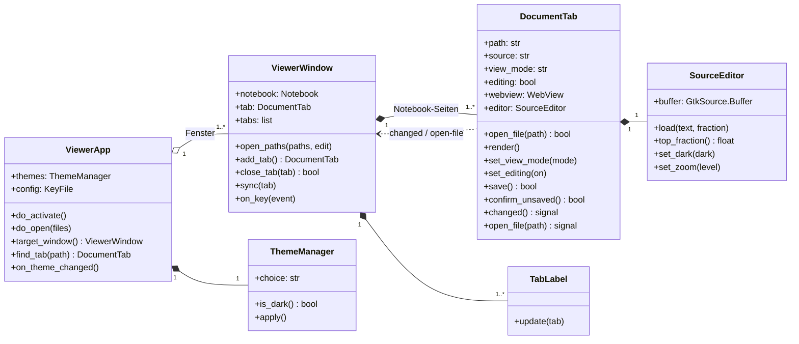
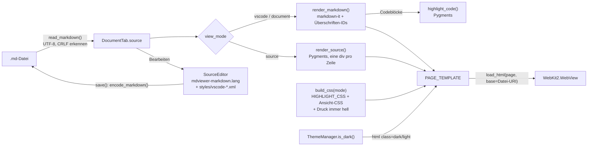
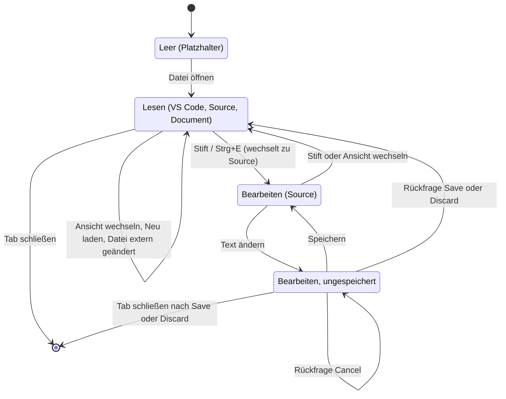
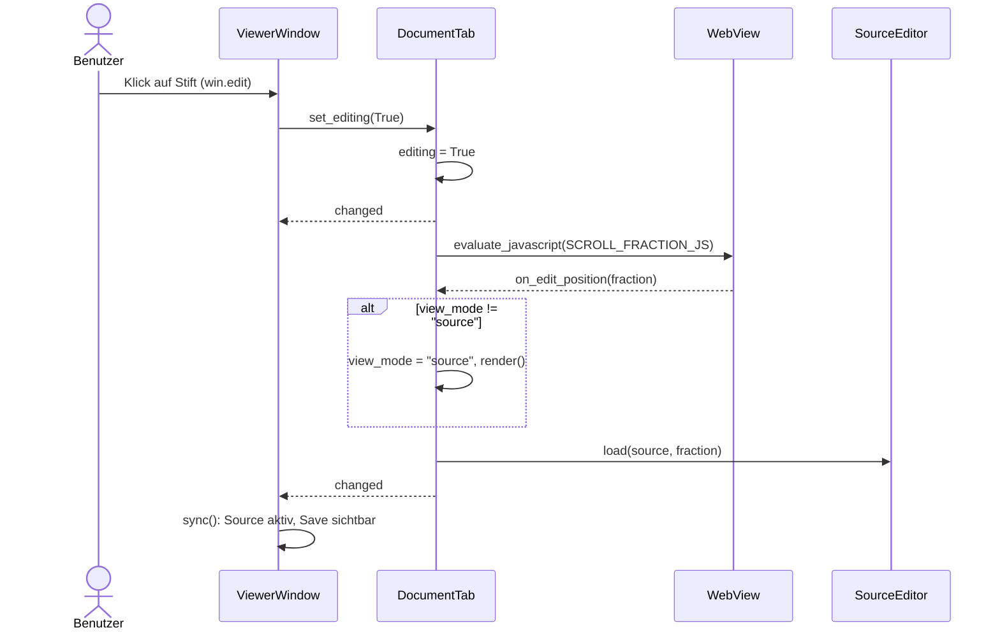
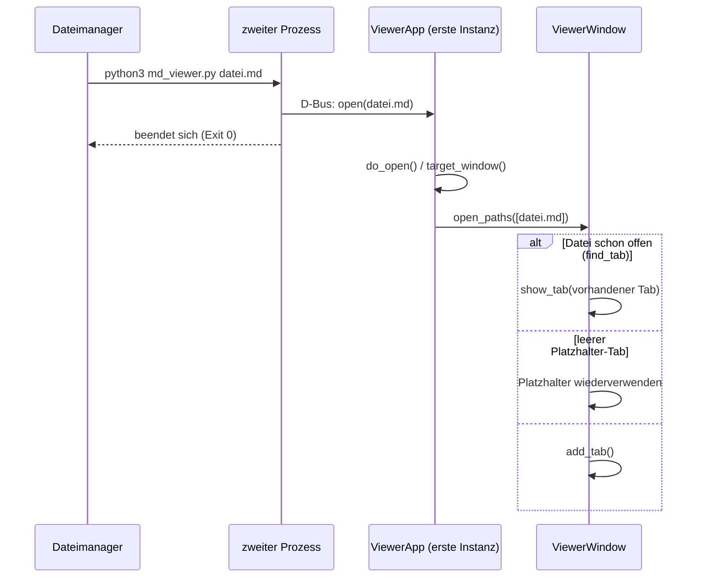

# Markdown Viewer – Entwicklerdokumentation

Stand: 07.11.2026

Diese Dokumentation richtet sich an Entwickler, die den Markdown Viewer verstehen, ändern oder erweitern wollen. Bedienung und Installation stehen im [Benutzerhandbuch](BENUTZERHANDBUCH.md) und in der [Anwenderdokumentation](ANWENDERDOKUMENTATION.md). Die fortlaufenden Projektnotizen mit Änderungshistorie stehen in [PROJECT.md](../PROJECT.md), offene Punkte in [OFFENE-PUNKTE.md](../OFFENE-PUNKTE.md).

> **Hinweis zu den Diagrammen:** Sie sind in Mermaid geschrieben. GitHub, GitLab und VS Code mit der Erweiterung „Markdown Preview Mermaid Support“ zeigen sie als Grafik. Der Markdown Viewer selbst zeigt sie als Codeblock, weil er in Dokumenten kein JavaScript ausführt.

## 1. Überblick

| Bereich | Technik |
|---|---|
| Sprache | Python 3.12, eine Datei (`md_viewer.py`, ca. 1 200 Zeilen) |
| Oberfläche | GTK 3 über PyGObject (`Gtk.Application`, `HeaderBar`, `Notebook`) |
| Anzeige | WebKit2GTK 4.1 (`WebKit2.WebView`), JavaScript in Dokumenten abgeschaltet |
| Editor | GtkSourceView 4 mit eigener Grammatik und eigenen Farbschemata |
| Markdown | `markdown-it-py` 3.0 (CommonMark + Tabellen + Durchstreichen + HTML) |
| Syntaxhervorhebung (Anzeige) | Pygments 2.17 |
| Versionsverwaltung | Git, Feature-Branches, Merge nach `main` mit `--no-ff` |

Es gibt keine Build-Schritte und keine Abhängigkeiten außerhalb der Distributionspakete.

## 2. Projektstruktur

```text
md-viewer/
├── md_viewer.py                    # die gesamte Anwendung (ausführbar)
├── styles/                         # GtkSourceView-Farbschemata für den Editor
│   ├── vscode-light.xml            #   VS Code Light+
│   └── vscode-dark.xml             #   VS Code Dark+
├── language-specs/
│   └── mdviewer-markdown.lang      # erweiterte Markdown-Grammatik für den Editor
├── tests/
│   └── test_tabs.py                # End-to-End-Test (29 Prüfungen) gegen die echte GTK-App
├── tools/
│   └── doku_screenshots.py         # erzeugt docs/bilder/ und docs/beispiel/ neu
├── docs/
│   ├── ANWENDERDOKUMENTATION.md    # Installation, Betrieb, Fehlerbehebung
│   ├── BENUTZERHANDBUCH.md         # Bedienung mit Screenshots
│   ├── ENTWICKLERDOKUMENTATION.md  # dieses Dokument
│   ├── bilder/                     # Screenshots für das Handbuch
│   └── beispiel/                   # Beispieldateien (auch Motiv der Screenshots)
├── PROJECT.md                      # Projektnotizen, Designentscheidungen, Changelog (englisch)
├── OFFENE-PUNKTE.md                # offene Fragen, Annahmen, Einschränkungen mit IDs
└── .gitignore
```

Außerhalb des Projekts:

| Pfad | Zweck |
|---|---|
| `~/.config/md-viewer/settings.ini` | gespeichertes Theme |
| `~/.local/share/applications/markdown-viewer.desktop` | Menüeintrag und Dateizuordnung |

### Aufbau von `md_viewer.py`

| Abschnitt | Inhalt |
|---|---|
| Kopf | Umgebungsvariablen für WebKit (vor dem Import!), Importe, Pygments optional |
| Konstanten | `VIEW_MODES`, `DEFAULT_VIEW_MODE`, `EDIT_VIEW_MODE`, `APP_ID`, Pfade, Editor-Schrift und -Schemata |
| CSS | `DOCUMENT_CSS`, `VSCODE_CSS`, `SOURCE_CSS`, `HIGHLIGHT_CSS`, `DARK_CHROME_CSS`, `PAGE_TEMPLATE` |
| Reine Funktionen | `build_css`, `render_markdown`, `render_source`, `read_markdown`, `encode_markdown`, `word_count` |
| `ThemeManager` | Hell/Dunkel/System auflösen und auf das GTK-Theme anwenden |
| `SourceEditor` | der GtkSourceView-Editor |
| `DocumentTab` | eine geöffnete Datei mit Anzeige, Editor und Zustand |
| `TabLabel` | Tab-Beschriftung mit Schließen-Knopf |
| `ViewerWindow` | Fenster mit Kopfzeile, Tabs und Statusleiste |
| `ViewerApp` | Single-Instance-Anwendung, Theme-Aktion, Einstellungen |

## 3. Architektur

### 3.1 Klassen



Grundprinzipien:

- **Der Tab besitzt den Zustand.** Datei, Inhalt, Ansicht, Zoom, Bearbeitungsmodus und Dateiüberwachung gehören zu `DocumentTab`. Das Fenster hält keinen eigenen Dokument-Zustand.
- **Das Fenster spiegelt den aktuellen Tab.** Die Fenster-Aktionen `win.view-mode`, `win.edit` und `win.save` tragen nur den Zustand des aktuellen Tabs (`ViewerWindow.sync()`). Ihre Handler geben Änderungen an den Tab weiter; der Tab entscheidet (z. B. Rückfrage) und meldet das Ergebnis über das Signal `changed`. Wird eine Aktion abgelehnt, ändert sich der Zustand nicht, und die Umschaltknöpfe bleiben richtig.
- **Signale statt Rückverweise.** Ein Tab kennt sein Fenster nicht. Er meldet `changed` (Zustand geändert) und `open-file` (Link oder abgelegte Datei); das Fenster reagiert. Dialoge hängt der Tab über `parent_window` (sein Toplevel) an.
- **Single Instance.** `ViewerApp` hat die feste `APP_ID` und kein `NON_UNIQUE`. GIO leitet weitere Starts über D-Bus an die erste Instanz weiter, die `do_open` ausführt.

### 3.2 Vom Dateiinhalt zur Anzeige



- Die Basis-URI ist die Datei selbst, damit relative Bilder und Links funktionieren.
- Beim Neuzeichnen (`rerender()`) wird die Scrollposition als **Anteil der Seitenhöhe** gelesen und nach dem Laden wiederhergestellt, weil die Ansichten unterschiedlich lang sind.
- Farben sind CSS-Variablen auf `:root` (hell) und `html.dark` (dunkel). `build_css()` kopiert alle `:root`-Variablen in einen `@media print`-Block, damit Ausdrucke immer hell sind.

### 3.3 Zustände eines Tabs



Im Zustand „Bearbeiten“ ignoriert der Tab Meldungen des `Gio.FileMonitor`, und Neu laden und Drucken sind gesperrt.

### 3.4 Ablauf: Bearbeiten starten



### 3.5 Ablauf: Datei per Doppelklick bei laufendem Viewer



## 4. Wichtige Details

| Thema | Umsetzung |
|---|---|
| Blanke Seite in VMs | `WEBKIT_DISABLE_COMPOSITING_MODE=1` und `WEBKIT_DISABLE_DMABUF_RENDERER=1` werden **vor** dem Import von WebKit gesetzt. |
| Keine Skripte | `set_enable_javascript_markup(False)`; eigenes JavaScript (Scrollposition) läuft trotzdem über `evaluate_javascript`. |
| Links | `on_decide_policy()`: Anker im Dokument laufen durch, `.md`-Dateien lösen `open-file` aus, alles andere geht an `Gtk.show_uri_on_window`. |
| Kodierung | `read_markdown()` liest Bytes, dekodiert strikt UTF-8 (sonst `lossless=False`, nicht editierbar), merkt sich `\r\n` und normalisiert auf `\n`. `encode_markdown()` stellt die Zeilenenden wieder her. |
| Editor-Grammatik | `mdviewer-markdown.lang` bindet `markdown.lang` ein und ergänzt Zitate und 27 Sprachen in Codeblöcken. Codeblöcke werden **zeilenweise** (`end-at-line-end`) eingebettet, sonst kann z. B. ein JS-Template-String das schließende ```` ``` ```` verschlucken. |
| Editor-Farben | `styles/vscode-*.xml` enthalten die Markdown-Stile (`markdown:*`, `mdviewer-markdown:*`) und die Code-Farben (`def:*`) aus `HIGHLIGHT_CSS`. Fehlen die Ordner, gelten `classic`/`oblivion` und `markdown`. |
| Theme der Fensterelemente | GTK 3 kann ein dunkles Theme nicht auf hell zwingen. `ThemeManager.apply()` setzt deshalb das passende Theme (z. B. `Mint-Y-Aqua` ↔ `Mint-Y-Dark-Aqua`), falls installiert, sonst `gtk-application-prefer-dark-theme`. Im Dark Mode hebt `DARK_CHROME_CSS` aktive Kopfzeilen-Knöpfe um ca. 10 % hervor. |
| Tastenkürzel | `ViewerWindow.on_key()` läuft vor dem fokussierten Widget, Kürzel funktionieren also auch im Editor. |

## 5. Erweitern

### Neue Ansicht

1. CSS-Konstante mit Variablen auf `:root` und `html.dark` anlegen.
2. In `VIEW_MODES` eintragen (Reihenfolge = Reihenfolge der Knöpfe und von Strg+1…).
3. `build_css()` und `BACKGROUNDS` um die Ansicht ergänzen.
4. In `DocumentTab.render()` festlegen, welcher Renderer die Ansicht erzeugt.
5. Für Strg+4 die Tastenliste in `on_key()` erweitern.

### Neue Sprache für Codeblöcke im Editor

In `language-specs/mdviewer-markdown.lang` einen `fence-*`-Block kopieren, die GtkSourceView-Sprach-ID (Dateiname unter `/usr/share/gtksourceview-4/language-specs/`) und die Kürzel eintragen und den Block in die Include-Liste von `mdviewer-markdown` aufnehmen.

### Neues Tastenkürzel

In `ViewerWindow.on_key()` einen Zweig ergänzen. Aktionen, die einen Tab betreffen, als Methode an `DocumentTab` aufrufen; dieser meldet Änderungen über `changed`.

## 6. Testen

```bash
python3 tests/test_tabs.py
```

- Der Test startet die echte App (ein Bildschirm ist nötig), steuert sie über die öffentlichen Methoden und gibt pro Prüfung `PASS` oder `FAIL` aus. Exit-Code 0 bedeutet: alles bestanden.
- Dialoge (`Gtk.MessageDialog.run`, `Gtk.FileChooserNative.run`) werden im Test durch Platzhalter ersetzt.
- **Pflicht in jedem Test:** `md_viewer.APP_ID` auf eine eigene ID setzen. Mit der echten ID würde ein laufender Viewer die Testdateien bekommen.
- **Pflicht in jedem Test:** `md_viewer.CONFIG_FILE` auf eine temporäre Datei setzen, damit die Einstellungen des Benutzers unberührt bleiben. `XDG_CONFIG_HOME` nicht umbiegen: dconf liest daraus die Desktop-Einstellungen, und der Test sähe dann ein falsches (helles) System-Theme.
- Ein Screenshot direkt nach einer Änderung kann den vorherigen Stand zeigen. Vor einer Aufnahme einen Zyklus der Hauptschleife abwarten.

Die Screenshots und Beispieldateien der Dokumentation werden so neu erzeugt:

```bash
python3 tools/doku_screenshots.py
```

## 7. Arbeitsweise und Konventionen

- **Git:** Jede Erweiterung auf einem eigenen Branch (`feature/...`), nach dem Test des Anwenders mit `git merge --no-ff` nach `main`.
- **Dokumentation pflegen:** Jede Änderung in `PROJECT.md` (Design, Prüfungen, Changelog) eintragen. Offene Fragen, Annahmen und Einschränkungen im selben Schritt in `OFFENE-PUNKTE.md` mit ID und Status festhalten.
- **Code:** Englische Bezeichner und Kommentare, Kommentare nur für das Warum. Reine Funktionen (Rendern, Lesen, Kodieren) ohne GTK-Abhängigkeit halten, damit sie ohne Oberfläche testbar sind.
